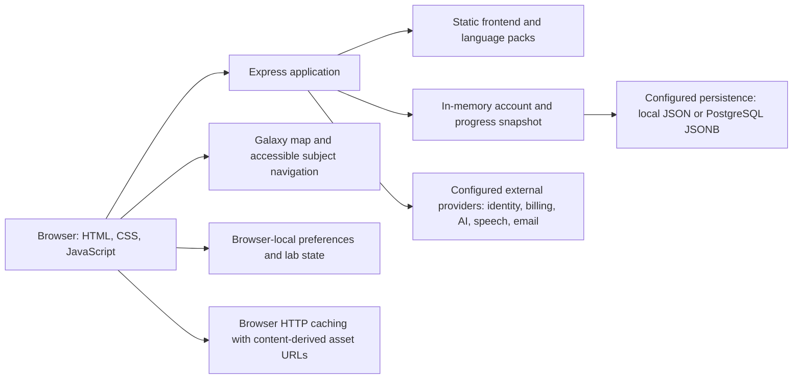

# Cosmica: existing architecture

**Inspection/update date:** 25 October 2026. This document describes the repository,
including pre-existing uncommitted work and the first runtime-stabilization slice.
It is not a deployed-system audit or a claim that the entire test suite passes.
Runtime verification uses isolated synthetic accounts; no production data or
external provider configuration is used.

**Homepage update:** 1 November 2026. The homepage now opens into nine animated
SVG galaxies and shows a subject catalog after selection. Other backend observations below
remain the dated baseline; this UI change does not establish new backend services.

**Latest presentation update, 6 November 2026:** shared UI follows the existing
language theme through the scoped [language chrome](../frontend/ui/language-chrome.css)
stylesheet. It covers homepage controls/catalogs, account surfaces, mathematics,
and legal/offline pages without changing the galaxy source, artwork, map positions,
or language interiors. The stylesheet is a versioned, focused build asset.

**Historical redesign, 1 November 2026:** the user has replaced the prior
visual direction with a cinematic cyberpunk universe throughout the
interface outside language course interiors. The local presentation uses amber/cyan
interface accents, animated galaxies, and direct galaxy selection. Existing registry IDs,
routes, learning/account contracts, HTML search/list navigation, reduced motion, and
operation without WebGL remain constraints. The redesign also themes account and
premium overlays, the mathematics preview, and legal/offline screens through scoped
styles. See the [source review](./UI_REDESIGN_AUDIT.md) and
[current verification](./UNIVERSE_UI.md); this is not a deployment claim.

The [vision](./COSMICA_VISION.md) specifies the target product. The
[roadmap](./ROADMAP.md) sequences changes from this baseline. Proposed capabilities
must not be read as implemented architecture.

## 1. System at a glance

Cosmica is a static multipage language-learning frontend served by a Node/Express
application. It has substantial account, billing, entitlement, progress, audio,
translation, and operational code. A full animated SVG galaxy map, subject navigation,
and a small mathematics studio coexist with the legacy language experience.

It is not yet the unified content, knowledge-graph, scientific-computation, and
research platform described in the vision.

The diagram shows code paths and configured options. It does not establish that
each provider is connected or that a deployed database has been inspected.

## 2. Runtime and repository boundaries

| Area                   | Verified implementation                                                                                                  | Main evidence                                                                                                                                |
| ---------------------- | ------------------------------------------------------------------------------------------------------------------------ | -------------------------------------------------------------------------------------------------------------------------------------------- |
| Runtime                | Node `>=24 <25`, npm `>=10 <12`; package version `1.2.0`.                                                                | [package.json](../package.json)                                                                                                              |
| Entry point            | `npm start` runs `node server.js`; the root entry requires the backend.                                                  | [server.js](../server.js), [backend/server.js](../backend/server.js)                                                                         |
| Web serving            | Express serves the static frontend and API routes in one application.                                                    | [backend/server.js](../backend/server.js): Express initialization, static middleware, API routes                                             |
| Frontend               | HTML pages, plain JavaScript, and CSS; 137 root frontend HTML files at inspection, including non-lesson pages.           | [frontend](../frontend/)                                                                                                                     |
| Shared browser runtime | Accounts, API access, preferences, progress, audio, and legacy gamification share a large runtime.                       | [frontend/app.js](../frontend/app.js)                                                                                                        |
| Language maps          | Embedded data, translation hydration, map rendering, grammar, filtering, and access/progress integration are coupled.    | [frontend/maps/app-maps.js](../frontend/maps/app-maps.js)                                                                                    |
| Styling                | Large shared stylesheets plus newer universe/studio styles.                                                              | [frontend/style.css](../frontend/style.css), [frontend/maps/style-maps.css](../frontend/maps/style-maps.css), [frontend/ui](../frontend/ui/) |
| Server organization    | Authentication, storage, billing, learning, provider proxies, and operations share a roughly 9,800-line CommonJS server. | [backend/server.js](../backend/server.js)                                                                                                    |

The existing [architecture boundaries](./ARCHITECTURE_BOUNDARIES.md) recommend
incremental domain extraction. [Source budgets](../scripts/check-source-budgets.js)
cap large files; those caps do not demonstrate separation of responsibilities.
There is no reason to replace the entire stack before establishing contracts and
measuring where it fails the intended journeys.

## 3. Language content and compatibility

### Twelve existing worlds

The repository contains Arabic, Chinese, Dutch, English, French, German, Hindi,
Japanese, Korean, Portuguese, Spanish, and Swedish worlds. The Portuguese UI is
Brazilian Portuguese. Each has metadata and route declarations under
[frontend/worlds](../frontend/worlds/).

The public routes are root HTML pages. English uses names such as
`english-world.html` and `english-letters.html`; other worlds use names such as
`world-french.html` and `letters-french.html`. The metadata, public URLs, legacy
world/map/section identifiers, account access, and existing progress are migration
contracts. The target hierarchy does not justify mass-renaming these records.

### Content representation

- Eleven non-English worlds use combined `translations.json` packs containing
  `generatedAt`, `worldLanguage`, `baseLanguages`, `words`, `phrases`, `grammar`, and
  `worldSource`.
- Words have 17 content sections plus labels; phrases have 16 plus labels. Grammar
  contains titles, examples, explanations, cards, and labels. Those five object
  categories are not five curriculum sections.
- English uses [maps/translations.json](../frontend/maps/translations.json), with
  a different structure; English grammar is also embedded in
  [app-maps.js](../frontend/maps/app-maps.js).
- Pre-rendered HTML, JavaScript datasets, generated material, and authored packs
  coexist. This is not a normalized content-management or publication system.

`app-maps.js` fetches the shared pack and then a language-specific pack where
applicable. It caches world translations under `cosmicaWorldTranslationsCache:v1`
with a 24-hour cache age. The shared runtime stores the base-language preference
under `cosmicaBaseLanguage` and calls the progress APIs.

Structural content and grammar checks exist. Their success would not establish
expert approval, native-speaker quality, full curriculum coverage, or proficiency
certification. Existing content needs an inventory and review status before a
future CMS import labels it approved.

### Public content and entitlements

Static HTML and packs are publicly served. Hiding a button or labelling a page
premium is not a confidentiality boundary. The
[premium access model](./PREMIUM_ACCESS_MODEL.md) distinguishes public material
from server-controlled entitlement and interactive behavior. Preserve actual server
checks and existing business behavior during changes.

## 4. Subject discovery and mathematics prototype

[universe.js](../frontend/ui/universe.js) defines a hardcoded nine-galaxy discovery
registry: Languages, Science, Computing, Engineering, Humanities, Health & Medicine,
Earth & Environment, Business & Economics, and Creativity. It exposes the 12
language destinations and `maths-lab.html`; other entries include unavailable URLs
and development labels.

This registry is presentation/discovery metadata. It is not the target knowledge
graph, a backend catalog, or proof that nine complete disciplines exist.

The scene source, [cosmic-scene.js](../frontend/ui/cosmic-scene.js), supplies original
animated SVG navigation. The 2 November subject artwork lives in
[subject-star-clusters.js](../frontend/ui/subject-star-clusters.js): seeded particles
trace nine subject symbols using a few batched SVG paths per cluster. The scene
controller owns selection, lifecycle, and motion; the artwork module owns symbol
geometry, palettes, and particle placement. Symbols stay upright while the diffuse
field rotates and bright stars shimmer. The new module is an explicit hashed build
input, so changing its artwork invalidates the generated artifact contract.
The space background lives in [space-backdrop.js](../frontend/ui/space-backdrop.js):
three seeded star depths, gradient nebula/dust clouds, and sparse bright stars.
The static SVG is encoded as a local data resource and displayed as a cached CSS
background; near stars use separate non-interactive HTML compositor layers. This
avoids repainting the entire nebula when a foreground symbol shimmers.
Its slow decorative motion updates at 15 Hz within the scene's existing pause and
visibility lifecycle. Initial phone/coarse-pointer rendering uses fewer stars.
It adds no SVG filters, raster assets, canvas, or WebGL dependency. Scoped CSS
provides a static star field when the scene bundle is unavailable. This module is
also an explicit hashed build input.
The homepage needs no WebGL, raster texture downloads, or
Three.js runtime. Native HTML owns category selection, search, filters, and course
links. Hover/focus previews leave selection and routes unchanged. The header has
the home logo, Search, and account access; phones retain Galaxies and Search.
Saved and Recently opened controls and tracking have been removed from this UI.
Reduced motion and the motion control stop continuous animation; offscreen scenes
and inactive tabs suspend updates. If the bundle is unavailable, a CSS illustration
and the complete HTML subject browser remain available.

The 1 November interaction refinement adds directional keyboard focus across the
map, fixed-target hover highlights, and named Previous/Next galaxy buttons in the
selected view. These buttons use the existing controller and history snapshots;
they introduce no catalog, account, or backend changes. Dismissing the independent
cookie notice preserves an open galaxy index, including the missing-bundle fallback.

[maths-lab.js](../frontend/ui/maths-lab.js) provides a browser-side linear-function
and tank model with linked graph/equation/table views, predictions, and presets.
The [studio page](../frontend/maths-lab.html) uses a standalone runtime. It does not
provide a general simulation service, research workspace, account-synced project,
or concept-level assessment engine.

| State                                     | Current owner/storage                                      | Limit                                                                  |
| ----------------------------------------- | ---------------------------------------------------------- | ---------------------------------------------------------------------- |
| Homepage browsing                         | Visit memory and namespaced browser history state          | Filters and positions are not account-synced; old bookmark records are untouched. |
| Mathematics studio work                   | Browser local storage, `cosmica:maths:linear-functions:v1` | Local prototype state; no server durability or cross-device guarantee. |
| Translation cache and language preference | Shared browser runtime/local storage                       | Not authoritative learning records.                                    |
| Account progress and entitlements         | Express account store, exposed through APIs                | Subject to the persistence and business-policy limits below.           |

### Build provenance and fallback navigation

[build-universe.js](../scripts/build-universe.js) bundles scene source through
esbuild into `frontend/ui/cosmic-scene.bundle.js`, exposed as `CosmicaRenderer`.
[index.html](../frontend/index.html) loads that generated bundle. The original
inspection found source/bundle drift; a fresh in-memory build reproduced it.
The focused builder now generates the renderer, asset manifest, and only the home
and mathematics pages' UI versions. `--check` rebuilds in memory and compares
artifacts without writing. The 30 October vector scene has no bitmap texture inputs.

The original fallback failure was reproduced against isolated Express: startup
selected the list after renderer failure, then routing hid it again. Navigation
now reconciles requested views with renderer capability. Without graphics, the
universe keeps its galaxy index and selected galaxies keep course lists. Back,
Escape, explorer controls, hashes, and history use this same rule. Context loss
preserves the selected galaxy and filter, removes the renderer, and recovers focus.

`window.cosmicaUniverse.getState()` exists with the SVG scene and missing-bundle
fallback, exposing `renderer`, `view`, `galaxyId`, `spatialAvailable`, and
`fallbackReason`. The subject catalog appears after selection in both cases. The
retained `map`/`list` values are diagnostic compatibility fields. No learning
routes, account API contracts, or existing stored bookmark records were changed.

Quality/release workflows now verify build provenance, run isolated regression
contracts, and exercise the universe in browsers. Render runs the built-in-only
asset/manifest checker after installing production dependencies. Configured CI
coverage is distinct from actual local verification results.

## 5. Backend domains and data flow

### Identity, access, and billing

[backend/server.js](../backend/server.js) implements email signup/login,
verification, password reset, Google OAuth, account management, sessions, and
premium/subscription/gift flows. Passwords use salted PBKDF2 SHA-512; session
tokens are random and stored as hashes. Session cookies are HttpOnly,
SameSite=Lax, and conditionally Secure.

Authenticated routes use `requireAuthenticatedUser` and the resolved account.
Admin API access uses a configured shared security token; admin HTML also has
Basic authentication. This is not a granular educator/research collaboration roles
system.

Stripe paths include raw-body webhook signature verification, subscription
restoration/management, portal, and checkout; production requires webhook
verification. Ko-fi webhook token validation and gift claims also exist. These
are real existing integrations in code, not placeholders to replace casually.
External-provider credentials, connectivity, and live event delivery were not
inspected.

### Persistence and acknowledgement

The server loads accounts, sessions, profile, progress, and billing metadata into
an in-memory `authStore`. Related operational/audit stores also exist. File storage
is the default configuration; PostgreSQL is an optional backend selected by
configuration.

PostgreSQL mode does not eliminate local persistence. Module initialization still
loads/normalizes local account files, and registered/deleted-account, blocking, and
security-event stores have file-backed queues. Include those files in persistent
volume, privacy, backup, and recovery planning rather than assuming the database
contains every record.

`getAuthStorePostgresPool` uses `pg.Pool`. `ensureAuthStorePostgresTable` creates
a snapshot table with `store_key`, `revision`, `payload JSONB`, and `updated_at`.
`persistAuthStoreToPostgres` writes the account-store snapshot, compares revisions,
and retries conflicts up to four times. This is PostgreSQL persistence, but not a
normalized relational model for content, attempts, concepts, or projects. The
presence of [neon.ts](../neon.ts) does not imply a separate implemented Neon data
layer; it contains an empty configuration.

`queuePersistAuthStore` writes file snapshots through temporary-file/rename or
calls PostgreSQL, and reports failures. `markAuthStoreDirty` starts persistence
without awaiting completion. Consequently a successful mutation response generally
does not establish a completed durable commit. Whole-snapshot concurrency and
multi-instance behavior need explicit validation before scale claims.

The next data design must distinguish accepted-in-memory, durably saved, and failed
operations; preserve record identity; and include migration, concurrency, failure,
and restore tests. Do not add a new database solely because the current backend
uses one snapshot.

### Learning records and review

The server implements progress normalization and world/map/section containers,
with `GET /api/progress`, `PUT /api/progress`, and `POST /api/progress/track`.
`deriveSectionMasteryStars` uses completion, activity, practice/review, and supplied
score heuristics. Review dates use fixed day intervals `[1, 3, 7]`.

This is partial progress/review functionality, not a calibrated concept mastery
model, misconception diagnosis, adaptive curriculum, or evidence-based assessment
service. Preserve XP, streaks, badges, completion, review history, and other legacy
records; do not convert them silently into proof of understanding.

Current full progress replacement and tracking are premium gated: relevant free
account paths can return unchanged progress and zero XP delta. This describes the
present implementation, not a recommendation for future access or pricing.

### AI, speech, and email

The server exposes OpenAI translation/chat, Google text-to-speech, and SMTP feedback
paths. The chat path forwards caller-provided messages to OpenAI. No reviewed
curriculum retrieval, citation validation, misconception orchestration, or tutor
evaluation pipeline was found in that implementation.

Provider routes have rate limits but no route-level authenticated-user requirement
in the inspected handlers. Cost admission, server-owned tutor policy, privacy, and
abuse controls need deliberate design before richer AI usage. Provider libraries
and endpoints do not establish a trusted tutor or a working external connection.

## 6. Security and operations

Existing middleware includes a JSON body limit, request identifiers, Helmet/CSP,
HSTS configuration, Permissions Policy, CORS, and route-specific rate limiting.
These are useful implemented controls, not evidence of a complete security audit.

The inspected limiters use process-local state and skip localhost host requests.
No explicit CSRF-token mechanism was found. Cross-origin mutation behavior, cookie
settings in deployment, origin validation, resource limits, and authorization
coverage require targeted verification. Do not equate CORS or SameSite alone with
a tested CSRF defense.

Request IDs, slow-request warnings, dependency-operation tracking, health endpoints,
failure-alert hooks, and web-vitals collection exist. Durable telemetry storage,
complete tracing, tested alert delivery, and measured service-level objectives
were not established by the inspection.

### Backups and test data

[create-backup.js](../scripts/create-backup.js), weekly backup automation, and the
repository restore drill address source archives/git bundles.
[create-auth-data-backup.js](../scripts/create-auth-data-backup.js) snapshots local
account-store files. Neither demonstrates live PostgreSQL backups, point-in-time
recovery, retention, or a tested restore of the authoritative deployed database.

[auth-test-store.js](../scripts/lib/auth-test-store.js) normally prepares a temporary
store, but supports environment overrides and copies local account/audit files
into its fixture. Temporary location does not mean synthetic data. Inspect test
configuration before running account/billing tests; prevent production targets
and private-data leakage. Cleanup recursively removes a non-default override
directory, so its resolved path must be verified as a disposable fixture directory.
Future fixtures should be synthetic by default.

## 7. Website assets and browser caching

[asset-version.js](../scripts/lib/asset-version.js) derives the shared fingerprint
from shared website JavaScript/CSS and maps JavaScript/CSS.
Spatial/studio assets use a separate focused contract in
[universe-assets.js](../scripts/lib/universe-assets.js): SHA-256 asset versions,
source/build-input hashes, the locked esbuild dependency, and a checked-in
[manifest](../frontend/ui/universe-assets.json). The builder versions ten UI assets
through twenty-two references across the homepage, studio, and four auxiliary pages.
The current vector scene has no texture URLs. Focused LF
attributes keep those hashes stable across Windows/Linux checkouts. This avoids
changing all legacy page versions for a homepage-only edit; shared-runtime changes
still require the existing `assets:sync` operation.

[service-worker.js](../frontend/service-worker.js) is only a retirement endpoint
for previously registered workers. It removes the former worker's own caches and
unregisters itself; it has no request handler. The server serves it with `no-store`.
New visits register no worker. Browser-local work and unrelated caches are preserved.

Cosmica is website-only as of 6 November 2026. Installation UI, manifests, native
source/configuration, platform dependencies, store links, and app-version reporting
have been removed. Website asset fingerprints and package release metadata remain.
Deletion of 46 unused binary icons/build assets under `android/`, `ios/`, and
`frontend/pwa/` was blocked by automatic approval review; these residual files have
no active integration. `test:website-only` checks website pages and legacy-worker
retirement using isolated stores.

## 8. Deployment and verification contracts

[render.yaml](../render.yaml) declares a Node web service in Oregon, `npm ci` followed
by `check:universe-assets` as the build, `npm start`, `/api/health`, commit-triggered deployment, Node 24.14.1,
and PostgreSQL account storage with pool size five. File bootstrap and fallback
are disabled in that configuration; secret values are external. This is deployment
intent, not confirmation of the running environment. Startup code checks database
TLS and pooled Neon URLs; actual credentials and connectivity remain unverified.

Commands are defined in [package.json](../package.json). The table describes their
scope; local runtime results are recorded in [the interface verification](./UNIVERSE_UI.md). Inspect other scripts and environment before execution.

| Command or check                                   | Useful coverage                                                                                  | Important limit or side effect                                                                                  |
| -------------------------------------------------- | ------------------------------------------------------------------------------------------------ | --------------------------------------------------------------------------------------------------------------- |
| `check:syntax`                                     | Root/server and legacy app/maps JavaScript parsing.                                              | Does not cover every new UI module; check changed modules explicitly.                                           |
| `build:universe` / `build:universe -- --check`     | Builds focused renderer/manifest/page versions; check compares a fresh in-memory build.          | Build writes focused outputs; check does not write.                                                             |
| `verify:universe`                                  | Isolated real Express, public route/cache/auth contracts, spatial and fallback browser journeys. | Uses fresh synthetic stores, exact-origin browser network policy, and OS-temp reports; no external preview URL. |
| `check:universe-assets`, `test:universe:contracts` | Production asset integrity; stale-artifact and preview-isolation regression tests.               | Built-in-only integrity check does not replace esbuild byte comparison or browser inspection.                   |
| `check:a11y`                                       | Automated baseline assertions.                                                                   | Does not replace keyboard, screen-reader, contrast, zoom, or motion inspection.                                 |
| `check:assets`, `check:html-cache`                 | Existing fingerprint and cache policy contracts.                                                 | Focused UI assets also require the dedicated universe checker.                                                  |
| Content/grammar checks                             | Structural assertions, semantic canaries, and declared content constraints.                      | Not comprehensive subject-expert or pedagogical validation.                                                     |
| `smoke`                                            | Local route/link availability.                                                                   | Does not prove useful lessons, durable state, or graphical correctness.                                         |
| `verify:viewport`                                  | Selected routes, widths 280–2560, Chromium/Firefox/WebKit by default, overflow/clipping reports. | Route subset and automated geometry; not every course, device, or assistive technology.                         |
| Billing/user-state contracts and continuity checks | Existing business and account regression coverage.                                               | Inspect store isolation and environment first; external/live checks have different effects.                     |
| `perf:check`                                       | Local HTTP timing/payload baseline.                                                              | Not GPU frame-time, memory endurance, real mobile, or worldwide loading evidence.                               |
| `security:audit`                                   | Configured dependency-audit policy.                                                              | Not a penetration test or a verified clean current dependency state.                                            |
| `quality`                                          | Aggregates several checks.                                                                       | Includes `check:seo`, which regenerates the sitemap; not a read-only docs check.                                |
| `assets:sync`, generators, `format`                | Explicit asset/content/format maintenance.                                                       | Mutate files; the format command is repository-wide. Use narrowly scoped tooling.                               |

The [quality workflow](../.github/workflows/quality.yml) runs selected syntax,
bloat, performance, audit, release, smoke, premium/checkout, browser, and account
contracts. It does not invoke the complete `quality` npm chain. Other workflows
cover release, security, uptime, indexing, backups, and repository restoration.
Configuration presence is not evidence that those jobs are currently green.

## 9. Capability gaps and documentation conflicts

| Vision capability                 | Inspected baseline                                           | Gap                                                                                        |
| --------------------------------- | ------------------------------------------------------------ | ------------------------------------------------------------------------------------------ |
| Knowledge graph and prerequisites | Hardcoded frontend discovery registry and language metadata. | No backend concept graph/prerequisite service found.                                       |
| Content management                | Authored/generated frontend assets and maintenance scripts.  | No structured editorial draft/review/publish system or versioned content repository found. |
| Diagnostics, mastery, adaptation  | Legacy section progress/stars and fixed review intervals.    | No concept evidence model, calibrated assessment, or adaptive sequencer found.             |
| Integrated modes and projects     | Separate language UI and local mathematics studio.           | No shared four-mode state contract or server-owned project revisions found.                |
| Scientific simulations            | One browser-side linear-function activity.                   | No general validated model registry or backend computation runner found.                   |
| Programming execution             | No execution platform found in the inspected backend.        | Isolation, resource governance, reproducibility, and operations remain to design.          |
| Grounded tutoring                 | External AI proxy paths.                                     | Retrieval, reviewed sources, checking, citations, and evaluation remain absent.            |
| Research and collaboration        | No research workspace/collaboration service found.           | Permissions, provenance, revisions, conflict handling, and sharing remain future work.     |

No distributed job system, event bus, vector-search layer, or normalized educational
domain migration system was found in the inspected backend. Their absence does
not itself justify adding them; introduce infrastructure to meet a measured need.

Existing documents contain conflicts that must not become implementation assumptions:

- [WORLD_PACK_SCHEMA.md](./WORLD_PACK_SCHEMA.md) describes split pack files and links
  schema/template/parity resources absent at inspection. Actual combined packs
  differ; treat that schema proposal as unimplemented until reconciled.
- [The worlds README](../frontend/worlds/README.md) calls non-English grammar
  inactive/Coming soon, while actual routes and authored grammar exist. Resolve
  exposure policy and review status separately; availability is not expert approval.
- [PROJECT_STRUCTURE.md](./PROJECT_STRUCTURE.md) encourages growing shared files;
  [ARCHITECTURE_BOUNDARIES.md](./ARCHITECTURE_BOUNDARIES.md) recommends extraction.
  The root [instructions](../AGENTS.md) establish the latter direction.
- [Historical vision ideas](./COSMICA_APP_VISION_IDEAS.md) include gamification that
  is not the current default product direction.
- [UNIVERSE_UI.md](./UNIVERSE_UI.md) now records the runtime milestone, safe preview,
  artifact contract, changed-file inventory, and local verification limits.

The four new canonical documents do not silently rewrite those historical files.
Reconciliation is a scoped roadmap task with source evidence and review.

## 10. Decisions still requiring evidence

Choose the final discipline taxonomy, normalized content/learner schema, durable
mutation contract, editorial process, assessment model, and supported device/network
matrix before multiplying courses. Establish the authoritative deployment, backup
and restore evidence, provider availability/cost boundaries, and realistic capacity.

Select simulation engines, execution isolation, retrieval technology, and collaboration
infrastructure through focused prototypes and threat/performance models. None is a
completed architectural decision merely because it appears in the vision.
