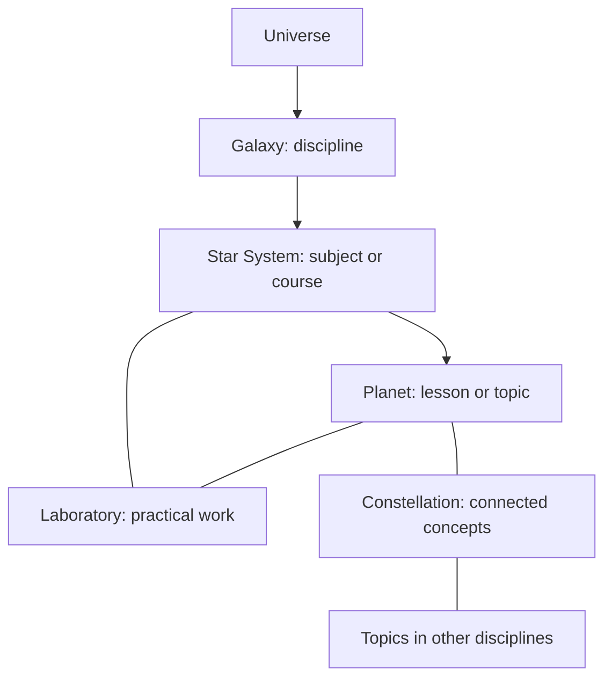

# Cosmica: product vision and experience specification

**Status:** canonical product direction, established 25 October 2026.
This is a specification, not a claim that its capabilities already exist.
See [the verified architecture](./ARCHITECTURE.md) for the current implementation
and [the roadmap](./ROADMAP.md) for sequencing and acceptance gates.

## 1. Purpose and standard

**Delivery decision, 6 November 2026:** Cosmica is a website. Native apps,
installation prompts, and app-store distribution are outside the product scope.
Responsive browser access remains required.

Cosmica is an interconnected universe of human knowledge for beginners, students,
educators, scientists, engineers, and lifelong learners worldwide. A person should
be able to discover an unfamiliar idea, receive rigorous teaching, investigate it
with useful tools, and connect it to deeper work in other disciplines.

The ambition covers the experience and the platform beneath it: original art and
interaction, excellent teaching, trustworthy computation, reliable personal work,
and a backend that makes these experiences durable and coherent.

The governing standard is **originality without clutter, power without unnecessary
complexity, breathtaking design without performance degradation, and educational
sophistication without sacrificing accuracy**. Worldwide success is an ambition
to test through outcomes, usefulness, accessibility, and sustained demand.

### Product principles

1. Understanding and useful work are the primary outcomes.
2. Interactivity has an intellectual purpose; animation also serves orientation
   and communicates changes of scale or state.
3. Clear navigation and accurate explanations remain available at every graphical
   quality level.
4. Exploration, structured learning, experimentation, and research reinforce one
   another through shared concepts and relevant state.
5. Each discipline has its own working logic within a recognizable Cosmica system.
6. Trust is earned through evidence, review, reliable records, and honest limits.
7. Valuable existing content and learner history are assets to preserve.
8. Build excellent complete journeys before multiplying shallow destinations.

## 2. Audiences and useful outcomes

| Audience                    | What Cosmica should make possible                                                                                             |
| --------------------------- | ----------------------------------------------------------------------------------------------------------------------------- |
| Beginner or curious visitor | Find a suitable starting point, manipulate an idea, and understand a first explanation without unnecessary setup.             |
| Student                     | Follow prerequisites, study a coherent course, receive diagnostic feedback, and demonstrate independent understanding.        |
| Educator                    | Inspect sources and outcomes, assign or demonstrate an activity, and understand evidence of student progress when authorized. |
| Engineer or scientist       | Use dependable models, calculations, datasets, references, and reproducible workspaces with explicit assumptions.             |
| Lifelong learner            | Resume work, revisit knowledge, explore connections, and retain projects across subjects and devices.                         |

Provide greater depth through progressive disclosure. An expert must be able to
reach technical work directly; a beginner must not need to understand the entire
cosmic hierarchy to start. Serving all these audiences is the long-term goal;
individual releases must name the audience and outcomes they actually support.

## 3. Knowledge architecture

| Entity        | Meaning                                                                                     | Example                                                                      |
| ------------- | ------------------------------------------------------------------------------------------- | ---------------------------------------------------------------------------- |
| Universe      | All of Cosmica and its connected knowledge.                                                 | The entry point, search, and cross-disciplinary discovery.                   |
| Galaxy        | A major discipline with its own identity and learning logic.                                | Languages or Mathematics.                                                    |
| Star System   | A subject or coherent course within a galaxy.                                               | French, linear algebra, or classical mechanics.                              |
| Planet        | A lesson or topic within a subject/course.                                                  | French question formation or conservation of momentum.                       |
| Laboratory    | A workspace for experimentation and practical work, linked to relevant subjects and topics. | A graphing workspace, circuit bench, or controlled programming environment.  |
| Constellation | Meaningful connections between ideas across disciplines.                                    | Sound waves connecting physics, music, signal processing, and pronunciation. |

This is an information model, not a requirement for a fixed number of navigation
screens. Search, direct URLs, saved work, and resume actions can bypass intermediate
views. Laboratories and constellations are connected resources, not artificial
levels that every learner must traverse.

**Future course structure, confirmed 30 October 2026:** each subject needs an
ordered path from beginner foundations to advanced application. Topics should have
explicit prerequisites, outcomes, and a clear next step rather than forming a random
collection. Direct topic navigation and search remain available; progression is
educational structure, not artificial unlock gates. This is later content/model
work. The current homepage task covers UI only and adds no lessons or curricula.

### Existing language worlds: compatibility contract

The Languages Galaxy already has 12 language worlds: English, French, German,
Spanish, Brazilian Portuguese, Dutch, Swedish, Arabic, Chinese, Japanese, Korean,
and Hindi. Preserve their valuable content, route names, identifiers, pronunciation
and translation behavior, account access, and progress.

In the target hierarchy, these existing course-level worlds map conceptually to
star systems. Existing visual planets and the persisted term `world` are legacy
representations. Future lesson/topic planets must be introduced through explicit
mapping; do not reinterpret course progress as lesson progress or mass-rename IDs.
Public language names can remain familiar while the internal model evolves.

### Discipline coverage

The coverage requirement includes Mathematics, Physics, Chemistry, Biology,
Technology, Computer Science, Programming, Engineering, Astronomy, Earth Sciences,
Oceanography, Philosophy, Logic, History, Psychology, and other significant fields.
Languages remains a foundational galaxy. Arts, design, economics, civic knowledge,
and health sciences are meaningful expansion areas when appropriate expertise exists.

This inventory is not an instruction to launch every field at once. Exact galaxy
groupings, stable IDs, and course boundaries require a reviewed taxonomy. For
example, Technology may connect several disciplines, and an existing Science gateway
may remain a compatibility collection while deeper disciplines acquire their own
identities. Navigation should distinguish broad collections from prerequisite and
concept relationships; the present homepage registry is not the final knowledge graph.

### Connection quality

Each constellation should explain why the connection matters and link to a useful
action or explanation. Distinguish prerequisite, application, analogy, shared model,
and historical relationship. Give links provenance and editorial ownership. An
automatically suggested association must not silently become an approved fact.

## 4. Four integrated learning modes

| Mode       | Main activity                                                                                      | Typical evidence or saved state                                                |
| ---------- | -------------------------------------------------------------------------------------------------- | ------------------------------------------------------------------------------ |
| Explore    | Discover through maps, manipulable objects, visual models, and connections.                        | Selected concepts, observations, bookmarks, and exploration parameters.        |
| Learn      | Follow structured teaching, worked examples, guided practice, diagnostics, and mastery evaluation. | Attempts, reasoning, feedback, learning objectives, and assessed evidence.     |
| Laboratory | Experiment with simulations, instruments, code, mathematical workspaces, and practical projects.   | Versioned configurations, inputs, code, results, notes, and reproducible runs. |
| Research   | Consult advanced references, derivations, verified sources, datasets, and analytical tools.        | Sources, assumptions, dataset versions, derivations, and reusable analyses.    |

These are views and working contexts within one learning system. Switching modes
should retain the relevant concept, project, notes, and experiment state. A learner
can explore a function, study its explanation, investigate it in a laboratory, and
open its derivation without recreating the same problem four times.

### Shared-state contract

- Use stable concept/content/project identifiers with versioned resource references.
- Preserve applicable parameters, units, language settings, inputs, and observations.
- Explain resets or incompatible model changes; do not silently discard work.
- Keep exploration history, lesson completion, and assessed understanding distinct.
- Make browser-local, unsaved, syncing, saved, offline, and failed states truthful.
- Persist sensitive or account-owned work with appropriate permissions and explicit
  retention behavior. A browser bookmark is not cross-device persistence.
- Support return and recovery: open a saved experiment in its original model version
  or present an explicit, reversible migration.

## 5. Teaching excellence

Teach with the rigor and care of an excellent professor. Depth comes from precise
explanations, appropriate examples, and meaningful learner activity. Text, diagrams,
audio, notation, and interaction should work together.

### Required lesson specification

Each substantive lesson or topic must define:

1. Intended audience, prerequisites, and observable learning outcomes.
2. A first-principles explanation, including relevant definitions and assumptions.
3. Appropriate linked representations: words, diagrams, equations, graphs, audio,
   code, or models as the subject requires.
4. Worked examples with the reasoning visible, followed by guided practice.
5. Learner actions that reveal a relationship, test a prediction, diagnose a mistake,
   or create an artifact.
6. A feedback model: likely misconceptions, specific explanations, and useful hints.
7. An independent task or transfer problem, including an assessment rubric or checker.
8. Delayed revision or retrieval opportunities appropriate to the skill.
9. Sources, authorship, review status, revision history, and licensing where applicable.
10. An accessible interaction and a useful alternative to any graphical-only action.

A useful activity can ask the learner to predict, manipulate, explain, and apply.
This is a design pattern, not a mandatory template for every subject. Dragging a
slider is insufficient unless the relationship and the learner's interpretation
are addressed. Long explanations remain valuable when the subject needs them;
progressive disclosure should manage density without hiding essential reasoning.

### Feedback, adaptation, and mastery

Feedback must address the learner's actual reasoning or observable error. Separate
syntax errors, conceptual misconceptions, approximation limits, and alternative
valid approaches. Provide a hint ladder before revealing a complete solution.

Adaptation should use declared prerequisites and meaningful evidence to recommend
practice or explanations. Make the recommendation understandable and allow learners
to choose another route. Do not infer mastery from time spent, visits, repeated
button presses, confidence alone, XP, or a completion checkbox.

A future mastery record should retain the objective, assessment/content version,
attempt context, use of hints, result, rubric/checker, timestamp, and later evidence.
Represent uncertainty and the need for review. Preserve legacy activity metrics
without silently converting them to scientifically validated mastery scores.

### Subject-specific learning environments

| Field                            | Appropriate interactions and forms of evidence                                                                                                                                                                                          |
| -------------------------------- | --------------------------------------------------------------------------------------------------------------------------------------------------------------------------------------------------------------------------------------- |
| Languages                        | Listening, speaking, script exploration, annotated reading, writing, sentence transformations, and communication with repair of misunderstandings. Assess skills separately; identify dialect, register, and pronunciation conventions. |
| Mathematics and logic            | Linked equations, graphs, geometry, tables, proof construction, counterexamples, and explicit reasoning. Distinguish numerical checks from proof.                                                                                       |
| Physics and astronomy            | Predictions, measurable simulations, vector/graph views, parameter changes, uncertainty, conservation checks, and model limits.                                                                                                         |
| Chemistry                        | Molecular structure, representations, reaction constraints, stoichiometry, and interpretable observations. A visual animation must not imply an unvalidated molecular model.                                                            |
| Biology and psychology           | Systems, evidence interpretation, variability, study design, and careful treatment of causal claims.                                                                                                                                    |
| Earth sciences and oceanography  | Maps, layers, time series, flows, field observations, datasets, and clearly stated spatial/temporal resolution.                                                                                                                         |
| Programming and computer science | Code execution in an appropriate sandbox, debugging, execution traces, algorithms, tests, correctness, and project work.                                                                                                                |
| Engineering and technology       | Models with constraints, dimensions, material assumptions, tradeoffs, failure analysis, instruments, and reproducible designs.                                                                                                          |
| History and philosophy           | Source comparison, timelines, argument structure, interpretation, competing explanations, and supported written reasoning.                                                                                                              |

For existing languages, retain native scripts, appropriate directionality,
base-language translation, audio, and useful romanization where relevant. Align
future courses with declared learning outcomes and reviewed proficiency descriptors;
do not claim accreditation or full proficiency coverage merely because pages exist.

## 6. Creative direction: cinematic universe, clear interaction

**Latest decision, 6 November 2026:** use the existing language UI as the shared
visual reference for borders, buttons, bars, headers, footers, and panels across
the site. Match its dark surfaces, muted violet accents, rounded controls, and
readable typography. Preserve the language interiors and the existing galaxy
artwork, lighting, positions, animation, and navigation. The earlier separate
amber/cyan interface chrome is superseded; the cinematic universe remains.

**Historical decision, 1 November 2026:** radically replace the visual interface outside
the language course interiors with an original cinematic universe. The
user requested a strongly animated cyberpunk space atmosphere, with the mood of
Blade Runner 2049 as a reference rather than artwork or identity to copy. Amber
light, cyan interface accents, deep space, and distinct animated galaxies
replace the earlier restrained visual direction. Preserve the language course
interiors, their functionality, and all existing learning/account records.

The universe itself remains the homepage. Nine visible galaxies are its primary
navigation; search and a complete list remain clear alternatives. Selecting a
destination reveals its existing subject catalog. Direct galaxy selection, hover
previews, and clear transitions support navigation, including reduced motion.
The 2 November 2026 artwork decision makes each galaxy's star cluster form its
subject symbol: translation bubbles, an atom, code brackets, a gear, an open book,
a heart/pulse, a globe, a growth chart, and an artist's palette. These symbols
are formed from visible stars within galactic dust and scattered star fields.
Keep the symbols upright and equally sized, with motion in the surrounding field
and star shimmer. Labels and ordinary HTML controls retain the navigation meaning.
The surrounding background reads as deep space: layered distant stars, a few
brighter nearby stars, and irregular nebula clouds. Keep it full-bleed and
subordinate to the subject symbols, with quiet contrast behind reading areas.
This is UI work: no new curriculum, knowledge graph, or subject tools are implied.
The 30 October and earlier 1 November designs are historical visual baselines,
superseded by this direction. Implementation and verification are recorded separately
in [the interface notes](./UNIVERSE_UI.md).

Navigation uses familiar words such as Subjects, Search, Start learning, and
Back. Cosmic terminology remains the domain model rather than vocabulary a visitor
must learn to navigate. Hover previews do not change the selected category or move
links. The homepage header contains the home logo, Search, and account access;
Saved and Recently opened are removed. On mobile, Galaxies and Search provide
persistent access, and normal page scrolling exposes the same catalog.
Learning modes appear only where their actual working context exists.
Copy should state the action or available material directly, without slogan-style
filler or claims of intelligent teaching that the product has not implemented.

Other subject environments may use spatial rendering when it improves their tools
and learning activities. The current components and layouts are not limits on
future design; reinvention must preserve content, account state, and direct routes.

### Composition and identity

- Establish a deliberate focal point, believable lighting, depth, material detail,
  scale cues, and quiet space. Avoid a flat sheet of repeated galaxy images.
- Give galaxies distinct celestial forms, atmosphere, pacing, and subject-specific
  behavior while keeping navigation recognizable.
- Use readable typography and concise language. Interface indicators should
  help orientation or navigation; keep decorative markings subordinate to names,
  course links, and controls. Prevent overlap at every supported viewport.
- Reveal names and controls when they support a decision. Keyboard focus and touch
  interaction must provide the same clarity as hover.
- Keep the meaning of place clear: the current galaxy, selected subject/topic,
  learning mode, and a reliable route back.
- Treat the cosmic layout as an educational representation. Do not imply that its
  spatial scale or decorative effects are a validated astronomical simulation.

### Motion and agency

Camera travel, transitions, and object motion should form a coherent sequence:
orientation, approach, arrival, and a usable working state. Provide anticipation,
acceleration, deceleration, and settling where appropriate. Input must remain
responsive, and travel must be interruptible or skippable.

Support looking around, approaching, selecting, inspecting, and returning. These
actions should change useful state, not merely trigger ornament. Within a galaxy,
the space should reveal its subjects and lessons clearly; within learning and
laboratory work, calm layouts and precise controls take priority.

The quality references are [Bruno Simon](https://bruno-simon.com/),
[Lusion](https://lusion.co/), [Active Theory](https://activetheory.net/),
[Kurzgesagt](https://kurzgesagt.org/), and [Roof Studio](https://roofstudio.tv/).
Use them to study craft, composition, motion, agency, and clarity. Cosmica needs its
own visual language and interaction model; do not copy their identities or assets.
The target is sustained production craft, not a claim of parity based on a screenshot.

### Sound and creatures

Sound is optional, visibly controllable, and muted initially. Use restrained
interface ambience, spatial cues, and expressive creature sounds where useful.
Pause or suspend audio appropriately when the experience is inactive. Every essential
cue must have a non-audio equivalent.

Small companions may add warmth, react to events, or offer unobtrusive assistance.
They must not obstruct work, repeat canned encouragement, or turn learning into a
points-and-rewards system. Playful interaction and visual delight are compatible
with professional tools; competitive ranks, compulsory streaks, and artificial
unlock gates are not the default direction.

## 7. Seamlessness, accessibility, and performance

Loading, hydration, camera changes, mode changes, and saving should be coherent.
Useful content must appear promptly, and resource-heavy visuals should enhance an
already operable experience. Avoid blank screens while a renderer or translation
pack loads.

Required capabilities include keyboard operation, visible focus, semantic controls,
screen-reader-compatible information, readable contrast, zoomable text, captions or
transcripts where needed, reduced motion, touch alternatives to dragging, RTL and
internationalization support, and responsive layouts.

Provide adaptive graphics based on measured capability, not just screen width.
Reduce pixel ratio, geometry, point density, effects, and update frequency as needed.
Handle unavailable graphics, context loss, storage restrictions, offline states,
and interrupted network requests. Essential learning must remain available through
a useful non-spatial route.

### Measurement contract

Before setting release budgets, identify representative devices, browsers,
viewport sizes, network profiles, and content cases. Initial engineering targets
are 60 FPS for the intended capable-desktop profile and a stable 30 FPS or useful
simplified view on the declared lower-capability/mobile profile. Measure input
latency, critical loading, layout stability, long tasks, transfer sizes, and memory
over repeated navigation. These are targets, not established current results.

Review visual quality and educational clarity alongside timings. A local HTTP
response-time check does not establish GPU performance or global loading quality.
Test audio-off, reduced-motion, keyboard-only, no-WebGL, and slow-network journeys.

## 8. Target platform capabilities

This section describes intended capabilities. It does not describe the existing
Express application as a completed learning platform.

| Domain                         | Required responsibility                                                                                                  |
| ------------------------------ | ------------------------------------------------------------------------------------------------------------------------ |
| Knowledge catalog and graph    | Stable concepts, typed connections, prerequisites, provenance, and efficient discovery across disciplines.               |
| Educational content management | Draft/review/publish lifecycle, structured lessons, versioned assets, localization, licensing, and rollback.             |
| Learning and assessment        | Attempts, rubric/checker results, diagnostic feedback, prerequisites, review scheduling, and evidence-based progress.    |
| Learner state                  | Reliable progress, projects, notes, experiment snapshots, permissions, conflict handling, export, and recovery.          |
| Scientific computation         | Versioned models, units, parameters, validation cases, reproducible runs, and declared numerical limits.                 |
| Programming execution          | Strong isolation, bounded resources, controlled dependencies, output limits, and safe handling of untrusted code.        |
| Research workspaces            | Verifiable sources, derivations, datasets, analysis tools, and reusable work with recorded assumptions.                  |
| Identity and access            | Secure authentication, ownership checks, roles, entitlements, session lifecycle, and privacy controls.                   |
| Operations                     | Validated APIs, observability, migrations, backups, restoration, testing, incident response, and deployment reliability. |

### Architectural direction and decision gates

Prefer clear domain boundaries and a modular application before independent
services. A normalized relational model with typed relationship tables is a candidate
starting point for the graph, not a mandate to purchase or install a graph database.
Choose specialized infrastructure only when workload, security, or isolation requires it.

Separate content identity from presentation, attempts from aggregates, and server
records from transient renderer state. Use validated contracts and explicit error,
retry, idempotency, versioning, and concurrency semantics. Define which successful
responses guarantee durable persistence and which work is asynchronous.

A proposed content model includes concepts, disciplines, courses, topics, learning
objectives, activities, assessments, model versions, sources, and reviewed relations.
A proposed learner model includes attempts, evidence, review items, project revisions,
experiment runs, and permissions. These are conceptual responsibilities pending
schema design and migration; they are not tables that already exist.

### Security and data reliability

Authorization and ownership must be enforced by the server. Do not trust client
progress, local storage, premium flags, or hidden UI as an authority. Protect
sessions, validate all mutation inputs, test cross-origin/CSRF behavior, and apply
appropriate abuse and resource limits to costly or public endpoints.

Preserve real user history during all migrations. Back up the actual authoritative
store, test restoration in isolation, and define recovery objectives. Do not treat
a source-code archive as a database backup. Record failures without exposing
credentials, tokens, private content, or unnecessary personal data.

Secure programming execution requires an isolated execution boundary with CPU,
memory, time, output, storage, filesystem, network, and process restrictions. Use
explicit dependency policy and reliable cleanup. Browser workers, Node `eval`, and
an unrestricted subprocess do not provide a general-purpose server sandbox.

### Scientific and tutoring trust

Scientific models need references, assumptions, dimensions, unit checks, validation
fixtures, tolerance criteria, and deterministic/reproducible configurations where
applicable. Distinguish pedagogical models from research-grade computation.

Tutoring should retrieve reviewed, versioned material, expose its sources, diagnose
the learner's error, and acknowledge uncertainty. Generated text must not fabricate
citations or certify correctness. Use deterministic checks and appropriate expert
review where available. A general chat endpoint is not a grounded tutoring system.

### Projects and future collaboration

Projects should support useful saved artifacts: programs, mathematical reasoning,
recorded language work, models, notes, and experiments. Record their relevant
versions and allow revision and export. Future collaboration requires explicit
ownership, sharing permissions, attribution, version/conflict handling, and
moderation appropriate to the audience. Do not introduce public sharing implicitly.

## 9. Technology selection

Use technology when it measurably improves an intended experience:

- Image generation for original artwork and graphical assets, with local project
  copies, recorded prompts/provenance, and deliberate integration.
- WebGL/Three.js for spatial scenes; WebGPU where compatibility, maintenance,
  performance, and fallback evidence support it.
- SVG, DOM, and efficient animation for precise, accessible interfaces.
- WebAssembly, workers, and numerical engines when computation justifies them.
- Specialized mathematics, physics, electronics, and programming components when
  their capabilities and licensing fit a reviewed requirement.
- AI assistance where reviewed knowledge, checking, privacy, latency, and cost can
  be controlled.

For each significant choice, state its problem, alternatives, accessibility,
compatibility, maintenance, security, performance, content implications, and
rollback path. Neither the current stack nor novelty alone should decide the answer.

## 10. Release and governance standards

Every release must identify its supported audience and genuinely available scope.
Unfinished subjects are labeled honestly; a visual destination is not a complete
course. Avoid fabricated progress, fake backend success, invented research tools,
or unsupported educational and scientific claims.

Use a representative end-to-end journey as the unit of delivery. Test content,
interaction, persistence, accessibility, responsive behavior, failure recovery,
and relevant security/performance together. Future implementation work must run
appropriate checks, inspect the rendered application, and report what was verified.

Maintain a clear distinction between canonical direction, verified architecture,
historical ideas, proposals, and open decisions. Changes to taxonomy, state,
assessment, security, or data ownership require explicit records and migration
consideration. The [roadmap](./ROADMAP.md) converts this vision into bounded work.
