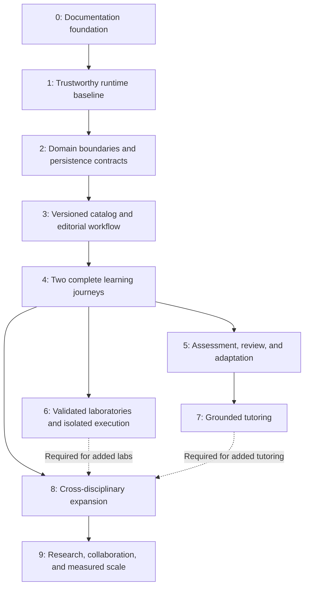

# Cosmica: transformation roadmap

**Established:** 25 October 2026. This roadmap implements the
[product vision](./COSMICA_VISION.md) from the
[inspected architecture](./ARCHITECTURE.md). It is a sequence of proposed work,
not a claim of delivered capabilities or a delivery-date commitment.

The four foundation documents are established. The first implementation milestone
is the Phase 1 runtime/asset slice: reliable universe entry and course access,
deterministic assets, and isolated browser verification. Other Phase 1 persistence,
security, and authoritative-store recovery requirements remain open; this milestone
does not complete the whole phase. See [the runtime evidence](./UNIVERSE_UI.md).

**Current steering:** runtime/browser triage is paused at the user's request while
interface UI work proceeds. Resume it on the user's word `huh`; see the exact
[runtime checkpoint](./RUNTIME_CHECKPOINT.md) before continuing its pending checks.

**Delivery decision, 6 November 2026:** website-only. Native wrappers, installation
prompts, PWA packaging, and app-store releases are removed from scope. Keep browser
navigation, responsive layouts, visitor work, and website cache invalidation intact.

**Latest visual decision, 6 November 2026:** use the existing language UI for shared
borders, buttons, bars, headers, footers, and panels throughout the site. Preserve
the language interiors and the galaxy artwork, lighting, positions, animation,
and navigation. The muted violet/dark language palette and rounded controls replace
the separate amber/cyan chrome. This remains UI-only work with existing content.

**Historical visual decision, 1 November 2026 — local implementation:** redesign
the interface outside language course interiors around an animated cyberpunk
universe. Amber/cyan accents, distinct galaxy destinations, and direct selection
replace the preceding visual direction. Preserve
language interiors, all nine discovery IDs, twelve language routes, account/progress
contracts, and the Universe → Galaxy → Star System → Planet model. This is UI-only
work using existing content and tools. Search, a complete galaxy list, fixed targets,
keyboard/touch access, reduced motion, optional sound, and operation without WebGL
remain required. The header retains only the home logo, Search, and account access;
phones retain Galaxies and Search. See the [source assessment](./UI_REDESIGN_AUDIT.md)
and [verification record](./UNIVERSE_UI.md) for delivered work and remaining limits.

**Subject-symbol artwork, 2 November 2026:** the local homepage replaces its generic
galaxy silhouettes with nine distinct subject symbols formed from star clusters.
Keep the shared responsive sizes, stable targets, labels, direct routes, and motion
preferences. This artwork refinement changes neither subject availability nor
course content; its runtime checks are recorded in the interface notes.
The surrounding full-bleed background adds layered stars and irregular nebula
clouds, with reduced density on phones and motion governed by the existing controls.

The decisions below describe the preceding implementation and retained interaction
contracts. Their visual styling is superseded by the latest decision above.

**Homepage decision, 30 October 2026:** implement clear category navigation and a
subject catalog with original animated 2D vector space artwork, familiar labels,
stable hover targets, mobile subject selection, and normal scrolling. Preserve the
nine existing discovery category IDs and twelve language routes. The final discipline
taxonomy remains a separate catalog decision. Required checks for this UI change
proceed within its scope; they do not resume the historical runtime investigation.
The current scope is UI only across subjects: existing content supplies navigation
destinations; new lessons, curricula, and subject tools are deferred.
Later subjects must provide an ordered beginner-to-advanced topic path with
prerequisites and next steps. Search and direct navigation should follow that
structure without presenting random topics as a curriculum.

The 31 October UI refinement adds actionable scene category controls, a labeled
phone navigation bar, shared search matching/scopes, and browser-history restoration.
It continues to use the existing catalog and links; no new topic content is included.

**Visual correction, 1 November 2026:** the opening homepage must be the universe,
with nine distinct animated galaxies as its primary navigation. The list is an
alternative drawer and the course catalog appears after galaxy selection. Preserve
search, touch/keyboard access, history, and existing routes; the UI-only scope remains.
The header is limited to the home logo, Search, and account access. Saved, Recently
opened, duplicate header galaxy controls, and the search prompt are removed.
Phones retain Galaxies and Search; one switcher lists every galaxy after selection.
The interactive map also supports directional keyboard focus and fixed-target
hover previews. Previous/Next galaxy buttons provide direct switching inside a
selected galaxy through the existing browser-history and filter-state contract.

## 1. Delivery rules and critical path

1. Preserve the 12 language worlds, public routes, valuable content, identities,
   entitlements, and progress throughout the transformation.
2. Stabilize real runtime, security, persistence, and recovery contracts before
   adding account-owned learning services.
3. Establish content identity and editorial quality before adaptive teaching or
   AI tutoring uses that content as an authority.
4. Deliver a small number of excellent complete journeys before broad expansion.
5. Evaluate subject accuracy, usability, accessibility, performance, and operational
   reliability together. A screenshot, green syntax check, or generated explanation
   alone is not a release gate.
6. Prefer incremental migration and a modular application. Introduce services or
   specialized infrastructure only for an evidenced requirement.

Visual and interaction prototypes may proceed alongside foundations using isolated
fixtures and explicit feature boundaries. Production adoption must satisfy the
same compatibility, accessibility, security, and performance gates. Do not let
visual exploration silently change account/data contracts.

## 2. Phase 0 — Establish the permanent foundation

**Priority:** immediate. **Dependencies:** repository inspection and the user's brief.

**Deliverables**

- Root [AGENTS.md](../AGENTS.md): concise recurring instructions and required reading.
- [COSMICA_VISION.md](./COSMICA_VISION.md): canonical product/experience specification.
- [ARCHITECTURE.md](./ARCHITECTURE.md): source-backed baseline, limitations, and gaps.
- This roadmap: ordered work with dependencies, checks, and acceptance criteria.

**Checks and acceptance**

- All four files exist, have valid local links, and consistently use Universe →
  Galaxy → Star System → Planet, with Laboratory and Constellation roles.
- The four modes, every explicitly requested discipline, preservation requirements,
  teaching standards, backend ambitions, and creative/performance principles are covered.
- Current, proposed, and unverified capabilities are clearly distinguished.
- Only these requested documents change during this task; no app rewrite, dependency
  installation, production-data operation, or generated-asset rebuild is included.

## 3. Phase 1 — Make the existing baseline trustworthy

**Priority:** P0, before a broader UI rollout or new account-owned features.
**Dependencies:** Phase 0. Changes must be bounded and independently reviewable.

### Runtime and asset correctness

- Reproduce the current scene-source/bundle drift and restricted-storage/no-WebGL
  failure against the actual served page.
- Correct the fallback's view/navigation behavior or demonstrate and fix an incorrect
  test expectation. Keep useful keyboard, touch, and direct-link access.
- Rebuild the renderer, assign consistent version/invalidation ownership to spatial,
  studio, and artwork assets, and make stale-artifact detection part of CI.
- Ensure the chosen deployment pipeline produces or verifies the artifact it serves.
  Do not rely on a developer remembering an undocumented manual build.
- Extend syntax and browser coverage to the new modules and fallback journeys.

### Security, test isolation, and recoverability

- Verify dependency-audit findings and address exploitable issues through scoped
  changes and regression tests; avoid blind mass upgrades or weaker audit policy.
- Replace private-account copies with synthetic contract fixtures. Validate any
  overridden test path as a disposable directory; cleanup must never target a
  workspace, real store, or production database.
- Review session/cookie/origin/CSRF behavior and provider-route admission/cost limits
  against concrete browser/API abuse cases. Preserve intended anonymous use with
  bounded resource policy.
- Identify every authoritative store, including local audit/security files in
  PostgreSQL mode. Document backup ownership, encryption/access, retention, recovery
  objectives, and operational configuration without recording secrets.
- Establish restoration of the actual account/progress/billing data in isolation.
  Source-code restoration alone does not satisfy this gate.

### Persistence acknowledgement

- Specify which mutation responses guarantee durable commit, how retries behave,
  and how clients show failure or pending work.
- Fix critical account/progress/billing acknowledgement paths and snapshot conflict
  behavior to meet that contract before new learning records depend on them.
- Keep this stabilization separate from an eventual normalized-schema migration.

**Tests**

Relevant syntax, source budgets, asset/cache, route smoke, account/billing contracts,
premium continuity, and browser checks; targeted no-WebGL, restricted-storage,
reduced-motion, keyboard, and mobile cases. Exercise persistence failure, retry,
restart, and concurrent update scenarios using isolated synthetic stores. Perform
an authorized database/file restore drill outside production. Inspect the rendered
served bundle and fallback in addition to reading source.

For billing, exercise duplicate, replayed, and out-of-order webhooks; crash/restart
around durable event acknowledgement; and provider reconciliation without losing
valid entitlements or incorrectly restoring revoked ones.

**Acceptance criteria**

- The page serves a demonstrably current renderer artifact; CI detects deliberate
  stale-bundle fixtures or mismatches.
- A visitor can discover and open existing language courses without WebGL or
  writable browser storage. The earlier failed case has a reproducible resolution.
- Defined durable-success responses survive restart; failed writes are observable
  and cannot appear as saved work. Concurrent writes follow documented conflict
  semantics without silently losing acknowledged changes.
- Test fixtures and cleanup are proven confined to disposable targets.
- A representative authoritative-store restore recovers account, entitlement, and
  progress relationships with verified counts/identifiers. Unresolved security or
  recovery risks have explicit release disposition rather than hidden exceptions.

## 4. Phase 2 — Establish domain boundaries and safe data evolution

**Priority:** P1 foundation. **Dependencies:** Phase 1 contracts and regression baseline.

**Deliverables**

- Incrementally extract identity/access, billing/entitlements, progress, storage,
  provider adapters, and operations behind existing Express routes. Keep external
  behavior stable while each boundary is isolated.
- Separate browser navigation/rendering, account/progress access, language content
  hydration, audio, and subject tools. Preserve static SEO and no-JavaScript content
  where currently available.
- Define validated request/response and repository contracts with authorization,
  errors, versions, concurrency, idempotency, and durable acknowledgement semantics.
- Design versioned migrations and content/progress compatibility adapters. Evaluate
  normalized domain repositories using real access patterns; do not mandate a
  graph database, event bus, or microservices in advance.
- Record architecture decisions, source ownership, and a rollback method for each
  extracted or migrated domain. Reconcile stale structure/schema instructions in
  separately reviewed documentation changes.

**Tests**

Run existing route/account/billing/progress contracts against the old and extracted
boundaries. Add failure/concurrency tests where behavior changes. Use representative
legacy fixtures for migration/reversal and compare stable IDs, entitlements, and
progress values. Verify static content, asset fingerprints, cache invalidation,
and representative rendered language pages.

**Acceptance criteria**

- Each extracted domain has one explicit public interface and can be tested without
  starting unrelated provider integrations.
- Existing public routes and supported API contracts remain compatible; all 12
  worlds remain reachable and their imported progress identifiers retain meaning.
- New domain features no longer require unrelated blocks in the largest runtime
  files. Source-budget compliance is supported by actual separation.
- Every data migration has dry-run evidence, invariant checks, recoverable backup,
  and a rehearsed rollback or forward-recovery procedure.

## 5. Phase 3 — Build the knowledge catalog and content workflow

**Priority:** P1. **Dependencies:** Phase 2 boundaries and data contracts.

**Deliverables**

- Approve a discipline taxonomy covering the vision's required fields. Distinguish
  broad compatibility collections from discipline galaxies and course star systems.
- Define stable concepts, courses, topics, objectives, activities, assessments,
  sources, model references, and typed relationships with schema versions.
- Implement a catalog and graph API using the simplest database/query model that
  passes representative discovery and prerequisite workloads.
- Import all 12 language worlds through adapters, preserving original source and
  legacy IDs/routes. Handle English's distinct representation explicitly.
- Build a real editorial draft → review → publish → retire/rollback workflow,
  including authorship, provenance, licensing, localization, and review status.
- Separate available, preview, and planned destinations in discovery. Present only
  real capabilities as usable learning experiences.

**Tests**

Validate schemas, imports, counts, identifiers, references, and round-trip exports.
Reject invalid relationships and invalid prerequisite cycles while allowing other
legitimate graph cycles. Test editorial permissions, immutable published versions,
rollback, localized fallback, direct URLs, and content caches. Have language experts
review representative imported material, including non-Latin scripts and RTL.

**Acceptance criteria**

- Every existing course route and legacy progress reference resolves through a
  documented mapping; import reports have no unexplained loss or duplication.
- An editor can create, review, publish, revise, and restore a topic without a
  manual edit to runtime JavaScript. Unauthorized publication is rejected.
- Published content records sources, version, reviewer/status, and language; an
  import does not automatically mark unreviewed material expert-approved.
- Catalog queries return reproducible relationships and prerequisites with
  provenance. A frontend list is no longer the only source of subject identity.

## 6. Phase 4 — Deliver two complete, distinctive learning journeys

**Priority:** P1 product proof. **Dependencies:** Phases 1–3. Prototype visual craft
earlier, then integrate against stable content/state contracts.

**Initial pilots:** an existing English sentence-pattern lesson sequence and
mathematics linear functions, building on the studio. Confirm precise outcomes and
reviewed content at kickoff; record any justified substitution. Keep other language
worlds functioning while these pilots establish the pattern.

**Deliverables**

- A realistic, original universe entry with coherent approach/arrival/return,
  subject identity, useful search/direct navigation, and restrained controls.
- Distinct language and mathematics environments. Language work supports meaningful
  listening/reading/writing or sentence manipulation; mathematics links equation,
  graph, table, prediction, explanation, and independent application.
- Explore, Learn, Laboratory, and Research views for each pilot. Research initially
  provides genuine sources, explanations/derivations, and reusable references
  appropriate to the pilot; do not present imaginary professional tools.
- Shared concept/project state across modes, account-owned saved revisions, and
  explicit local/unsaved/syncing/saved/failed states. Support export and recovery.
- Reviewed lesson specifications: prerequisites, outcomes, first principles, worked
  examples, guided practice, misconceptions, independent task, and later revision.
- Optional muted-by-default sound and restrained companion behavior where useful.
  No compulsory points, streaks, ranks, or unlocks in the new journeys.

**Tests**

Inspect rendered journeys on the declared browser/device matrix. Test keyboard,
screen reader, touch, zoom, reduced motion, audio off, no-WebGL, slow network,
storage restrictions, save failure, reload, and cross-device resume. Validate
mathematical values/units and language examples with appropriate reviewers. Use
task-based learner sessions to observe navigation and explanation comprehension.

**Acceptance criteria**

- A new visitor can reach a suitable pilot, complete its independent task, inspect
  useful references, save work where entitled, and resume without losing relevant
  mode parameters. Failed saves remain visible and recoverable.
- Each pilot meets its published lesson specification and subject review criteria.
- Every essential action works without hover, sound, or the spatial renderer.
  Planned destinations and optional effects do not obstruct learning.
- Visual craft is reviewed in motion, and performance meets the measurement
  contract below on named hardware. Unresolved critical usability issues block
  expansion, even if the scene is visually impressive.

## 7. Phase 5 — Add trustworthy assessment, revision, and adaptation

**Priority:** P2. **Dependencies:** durable persistence contracts from Phase 2,
reviewed objectives/content, and pilot learning journeys from Phases 3–4.

**Deliverables**

- Versioned attempts/evidence with objective, task, rubric/checker, hints, result,
  timestamp, and relevant context. Keep raw evidence distinct from aggregates.
- Subject-specific diagnostic feedback, misconception handling, hint ladders,
  independent transfer tasks, and spaced retrieval/revision.
- A transparent recommendation engine using prerequisites and observed evidence;
  learners can inspect the reason and choose another path.
- A documented mastery/uncertainty model. Preserve legacy activity records as
  legacy data; do not manufacture mastery by converting XP or visits.

**Tests**

Check correct and alternative valid answers, common misconceptions, partial work,
hint usage, repeated attempts, content-version changes, and review scheduling.
Verify retry/idempotency and cross-device consistency. Use expert-scored examples
and a predeclared evaluation protocol, including delayed and transfer assessment.
Set the sample, rubric, uncertainty thresholds, and go/no-go criteria before
collecting pilot results; report the actual evidence and limits.

**Acceptance criteria**

- The system can explain why practice or review is recommended and show the
  evidence/version behind a mastery estimate.
- Completion, time spent, visits, and confidence alone cannot produce mastery.
- Independent checks distinguish targeted misconceptions and valid alternative
  reasoning in the supported task set.
- Pilot evidence meets the declared criteria before adaptation is advertised as
  effective; uncertain cases use conservative guidance and allow learner control.

## 8. Phase 6 — Establish validated laboratories and isolated programming

**Priority:** P2. **Dependencies:** Phases 2–4; assessment integration uses Phase 5.
Scientific model work and execution isolation are separate deliverables.

### 6A. Scientific and mathematical laboratories

- Build a versioned model/experiment contract: assumptions, units, bounds, solver,
  source references, reproducible inputs, outputs, and known limitations.
- Extend the mathematics pilot and add a bounded physics laboratory, such as a
  conservation-of-energy investigation, before multiplying simulation categories.
- Evaluate workers, WebAssembly, numerical engines, and specialist tools through
  accuracy, licensing, compatibility, performance, and maintenance prototypes.
- Add saved experiment runs and exports using the common project/state contract.

**Tests and acceptance:** reference solutions, dimensional checks, conservation or
other model invariants, edge cases, numerical tolerance/convergence, reproducible
runs, cancelled computation, and accessible alternatives. Publish supported bounds
and tolerances. The selected model must pass expert-reviewed cases and reproduce
a saved run at the declared model version. A compelling animation alone cannot
qualify as a validated simulation.

### 6B. Programming execution

- Select a first language/use case and execution architecture through a threat
  model and resource/cost measurements. Establish a boundary independent of the
  web application process.
- Enforce CPU, memory, wall time, output, filesystem, network, process, dependency,
  and storage limits; isolate users and reliably clean up work.
- Provide genuine compiler/runtime errors, traces or debugging where supported,
  tests, saved code, and reproducible runtime versions.

**Tests and acceptance:** demonstrate termination of infinite loops and excessive
allocation/output; denial of prohibited filesystem/network/process access; tenant
separation; crash recovery; cancellation; cleanup; authorization; and bounded
admission under load. Release requires a reviewed isolation design and passing
adversarial tests in a dedicated environment. Never execute arbitrary learner code
inside Express, unrestricted subprocesses, or a browser worker presented as a
general server sandbox.

## 9. Phase 7 — Introduce grounded tutoring

**Priority:** P2, after reliable content and evidence. **Dependencies:** Phases 3–5;
tool-using tutoring also requires the corresponding Phase 6 safety gates.

**Deliverables**

- Server-owned tutoring policy and retrieval over reviewed, versioned material.
- Traceable sources, appropriate hints, misconception-sensitive explanations,
  deterministic checks where available, and honest uncertainty/abstention.
- Authorization, data minimization, privacy/retention, cost/latency budgets, abuse
  controls, and failure recovery. Anonymous access, if offered, is explicitly bounded.
- An evaluation set spanning correctness, pedagogy, source fidelity, multilingual
  behavior, prompt injection, and prohibited data/tool access.

**Tests and acceptance**

The tutor must cite existing accessible source versions, avoid fabricating sources,
keep account/project data isolated, and respect tool permissions and budgets.
Define quantitative quality thresholds and severe-error release blockers before
evaluation. Inspect both automated results and expert-reviewed conversations.
Publish only the supported domain scope. A forwarded chat completion does not
satisfy this phase.

## 10. Phase 8 — Expand through useful constellations

**Priority:** P3. **Dependencies:** the relevant pilot, editorial, laboratory, and
assessment gates; tutoring is required only where the new experience uses it.

**Deliverables**

- Prioritize additional courses through learner need, reviewer availability,
  prerequisite coverage, tooling readiness, and sustainable operating cost.
- Cover the full required discipline inventory over successive releases. Give
  each discipline its own educational tools and identity; do not clone one lesson
  template with new labels.
- Create curated constellations such as sound across physics/music/pronunciation,
  or functions across mathematics/programming/engineering. Store relation type,
  provenance, and a useful next action.
- Add localization and culturally appropriate examples with maintained review,
  scripts, directionality, audio alternatives, and regional terminology.

**Tests and acceptance**

Every launched course meets the lesson, content, accessibility, state, and subject
validation gates. Each cross-disciplinary connection is reviewed and leads to a
real explanation, activity, or reference. Add a discipline only when its core
journey is useful independently and its prerequisites make sense. Measure learning,
successful task completion, return-to-work reliability, and user feedback; avoid
using clicks or session duration alone as proof of educational value.

## 11. Phase 9 — Develop research, collaboration, and measured scale

**Priority:** P3, demand-led. **Dependencies:** proven individual projects, reliable
operations, reviewed advanced content, and explicit research-user requirements.

**Deliverables**

- Advanced workspaces with verifiable references, dataset/model versions, derivations,
  reproducible analysis, provenance, export, and stated numerical limitations.
- Explicit project ownership, private-by-default sharing, roles, attribution,
  revision/conflict handling, and appropriate moderation before collaboration.
- Capacity planning, durable observability, incident response, recovery objectives,
  and cost controls using observed workloads. Introduce independent workers,
  services, search infrastructure, or real-time systems only where justified.
- Native/offline capabilities as separately verified products; wrappers and service
  worker registration alone do not establish feature parity.

**Tests and acceptance**

Validate reproducibility, reference integrity, export/import, permission matrices,
revocation, concurrent edits, deletion/retention, tenant separation, and recovery.
Run representative load and failure drills. A pilot engineer/scientist must be
able to perform an agreed real task and independently verify the result. Publish
supported precision, sources, limitations, and service expectations; do not claim
research-grade reliability from visual polish or unreviewed generated content.

## 12. Measurement and release contract

These are proposed engineering gates, not current measured results:

| Area                    | Required evidence                                                                                                                                        |
| ----------------------- | -------------------------------------------------------------------------------------------------------------------------------------------------------- |
| Compatibility           | Twelve-world route/content/progress mapping report; account and entitlement regression checks.                                                           |
| Educational quality     | Reviewed objectives, explanations, representations, feedback, independent tasks, sources, and declared evaluation results.                               |
| Visual experience       | Rendered motion/interaction inspection on named devices; coherent travel, subject identity, and clear working state.                                     |
| Performance             | Critical loading, input latency, frame-time distribution, memory, transfer size, and repeated-navigation measurements on stated device/network profiles. |
| Initial graphics target | 60 FPS on the declared capable desktop profile; stable 30 FPS or a useful simplified view on the declared lower-capability/mobile profile.               |
| Accessibility           | Keyboard, screen reader, touch, zoom, contrast, reduced motion, audio-off, and no-WebGL task completion.                                                 |
| Reliability             | Durable acknowledgement, retry/idempotency, concurrency, interrupted network, save failure, restart, and authoritative-store restoration evidence.       |
| Security                | Authorization/ownership, origin/session behavior, data isolation, resource controls, dependency findings, and relevant execution/tutor abuse cases.      |

Name representative hardware, browsers, networks, content, measurement method, and
numeric loading/latency/memory budgets before the corresponding implementation
release. Record regressions against comparable profiles. Do not invent current
measurements or dilute baselines to turn failures green.

Every implementation handoff should state the delivered behavior, preserved
contracts, changed files, actual checks and rendered inspection, remaining limits,
and rollback considerations. Update the canonical documents when decisions change.
Passing a phase gate authorizes considering the next scope; it is not blanket
permission to migrate production data or publish external changes.
